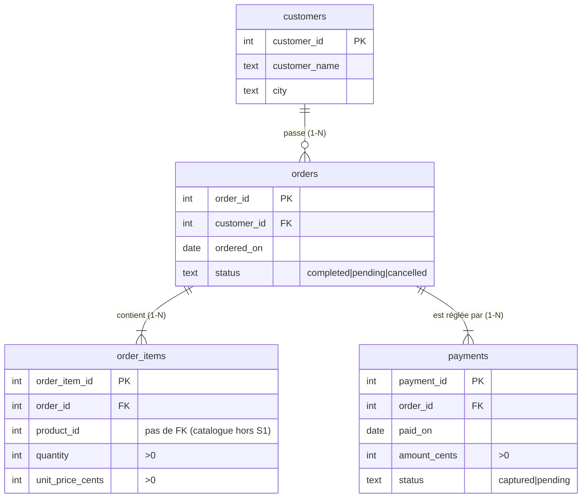

# NovaMarket — S1 à S3 : SQL relationnel, SQL avancé et benchmark

**Auteur :** Lucas Massako — M1 Data IA, YNOV

Base PostgreSQL 17 (Docker) construite à partir des fichiers de `s1/donnees/` (ventes) et `s2/donnees/` (catalogue), plus un jeu de benchmark séparé de 10 millions de lignes (`s3/`). Tous les montants sont en **centimes** (`integer`) et ne sont convertis en euros qu'à l'affichage.

## Exécution

Prérequis : Docker Desktop lancé. Toutes les commandes se tapent depuis `novamarket/`.

```bash
bash run_s1.sh          # S1 : démarre PostgreSQL, recrée le schéma, importe les ventes, écrit les preuves
bash run_s2.sh          # S2 : intègre le catalogue, lance les analyses avancées
bash run_s3.sh          # S3 : génère le benchmark (si absent) et mesure avant / après index
```

L'ordre compte : `run_s1.sh` recrée les schémas `reception` et `metier`, ce qui efface aussi le catalogue. Après un `run_s1.sh`, il faut donc relancer `run_s2.sh`. Le schéma `benchmark` n'est jamais touché par S1 ni S2.

Pour lancer les scripts un par un :

```bash
docker compose up -d --wait postgres
docker compose exec -T postgres psql -X -v ON_ERROR_STOP=1 -U atelier -d novamarket < sql/01_schema.sql
docker compose exec -T postgres psql -X -v ON_ERROR_STOP=1 -U atelier -d novamarket < sql/02_import.sql
docker compose exec -T postgres psql -X -U atelier -d novamarket < sql/03_controles.sql
```

| Fichier | Rôle | Mission |
|---|---|---|
| `sql/01_schema.sql` | Schémas `reception` (brut, texte) et `metier` (typé, contraint), table `reception.rejets` | M1, M2 |
| `sql/02_import.sql` | `\copy` CSV/NDJSON → réception → journal des rejets → métier, dans une seule transaction | M2 |
| `sql/03_controles.sql` | Volumes reçus / intégrés / rejetés, journal des rejets, contrôles de cohérence | M2, M5 |
| `sql/04_indicateurs.sql` | Commandes par statut, clients sans commande, CA, panier moyen, rapprochement des paiements | M3 |
| `sql/05_anomalies.sql` | Doublons, orphelins, multiplication des montants par jointure, effet du statut sur le CA | M4 |
| `sql/06_normalisation_A1.sql` | Anomalies d'insertion, de mise à jour et de suppression, puis version normalisée (tout est annulé par ROLLBACK) | A1 |
| `sql/07_catalogue.sql` | Réception, rejets et intégration de `categories` et `products` ; clé étrangère `order_items → products` | S2 M1 |
| `sql/08_controles_catalogue.sql` | Volumes, doublons de fiches, couverture des codes produit, cohérence des dates, hiérarchie | S2 M1 |
| `sql/09_analyses_avancees.sql` | `RANK`, `LAG` / `LEAD`, CTE, `NTILE(4)`, `WITH RECURSIVE` | S2 M2–M5 |
| `s3/generer.sql` | Générateur fourni (schéma `benchmark`, 10 000 000 lignes) | S3 |
| `sql/10_benchmark_mesures.sql` | Plans `EXPLAIN (ANALYZE, BUFFERS)` avant / après index, mesures répétées, index forcé, jointure multiplicatrice, écart estimé / réel | S3 |
| `run_s1.sh`, `run_s2.sh`, `run_s3.sh` | Rejouent chaque séance et écrivent les sorties dans `preuves/` | — |
| `.env` | Port hôte (`15432`) et sous-réseau Docker, à modifier en cas de conflit | — |

Les scripts sont **rejouables** : `01` recrée les schémas et `02` vide puis recharge. Les fichiers bruts de `s1/` ne sont jamais modifiés, car ils sont montés en lecture seule.

## M1 — Modèle relationnel

Grain de chaque source : une ligne = un client, une commande, une ligne d'article ou une opération de paiement.



L'ordre d'import suit les dépendances : `customers` → `orders` → `order_items` et `payments`.

**Choix de conception justifiés**

1. **Réception en texte, puis métier contraint.** Les tables `reception.*` n'ont ni types ni contraintes, donc aucune ligne ne peut faire échouer le `\copy`. Chaque ligne garde un `ligne_id` (sa position dans le fichier). Les règles sont ensuite vérifiées en SQL. Une ligne invalide va dans `reception.rejets`, avec son motif et son contenu brut, au lieu d'arrêter l'import ou de disparaître. On peut ainsi toujours vérifier que reçus = intégrés + rejetés.
2. **Montants en `integer` (centimes) et prix stocké sur la ligne.** On évite les erreurs d'arrondi des flottants. `unit_price_cents` est le prix au moment de l'achat : il reste sur la ligne d'article et n'est pas déduit d'un catalogue. C'est aussi pourquoi `product_id` n'a pas de clé étrangère (le catalogue est hors périmètre S1).

Autres contraintes : clés primaires sur chaque identifiant source, clés étrangères vers `orders` et `customers`, `CHECK` sur les statuts (sensibles à la casse) et sur les valeurs strictement positives, index sur les clés étrangères.

## M2 — Volumes

| Source | Reçus | Intégrés | Rejetés |
|---|---:|---:|---:|
| customers.csv | 180 | 180 | 0 |
| orders.csv | 400 | 400 | 0 |
| order_items.csv | 802 | 800 | 2 |
| payments.ndjson | 480 | 480 | 0 |

**Journal des rejets** (`reception.rejets`)

| Source | Ligne | Clé | Motif |
|---|---:|---|---|
| order_items.csv | 801 | order_item_id 7 | doublon de `order_item_id` (même commande 4, même produit, mêmes valeurs ; 1re occurrence conservée) |
| order_items.csv | 802 | order_item_id 801 | commande 9999 inexistante (référence orpheline) |

## M3 — Indicateurs

| Indicateur | Résultat | Hypothèse / dénominateur |
|---|---|---|
| Commandes par statut | completed 320 (80 %), pending 40, cancelled 40 | 400 commandes intégrées |
| Clients sans commande | 30 sur 180 | `NOT EXISTS` sur `orders` |
| CA des lignes des commandes terminées | **26 210,00 €** (2 621 000 centimes) | Σ `quantity × unit_price_cents`, statut `completed` uniquement |
| Panier moyen | **81,91 €** | CA ÷ **320 commandes completed** (pas ÷ 800 lignes, pas ÷ 360 paiements) |
| Encaissé sur commandes completed | 26 210,00 € | Paiements `captured`, agrégés par commande avant la jointure |

**Contrôle de cohérence** : après rejet du doublon, les 400 commandes ont un total d'articles égal à la somme de leurs paiements (les deux sont agrégés par commande). Les commandes completed sont entièrement `captured`, les commandes pending entièrement `pending`.

## M4 — Anomalies

| Anomalie | Détection | Effet si on l'ignore | Décision |
|---|---|---|---|
| Ligne d'article en double (id 7, commande 4) | `GROUP BY` sur toutes les colonnes, `HAVING count(*) > 1` | Commande 4 à 87,50 € au lieu de 53,75 €, alors que 53,75 € ont été payés ; CA surévalué de 33,75 € | Rejet de la 2e occurrence, tracé dans le journal |
| Ligne d'article orpheline (commande 9999) | `NOT EXISTS` vers `orders` | Montant de 6,25 € rattaché à aucune commande ; la clé étrangère bloquerait l'import | Rejet, tracé dans le journal |
| Jointure directe articles × paiements | Comparer avec une agrégation préalable par commande | Lignes multipliées : 720 au lieu de 320 ; CA 29 472,50 € au lieu de 26 210 € (+12 %) ; paiements 52 420 € au lieu de 26 210 € (×2) | Toujours agréger chaque table par commande **avant** de joindre |
| Paiements en deux fois de même montant (ex. commande 5 : 2 × 27,50 €) | `GROUP BY order_id, montant, date` | Les supprimer comme faux doublons sous-évaluerait les encaissements | **Conservés** : `payment_id` distincts et somme égale au total des articles |
| Commandes annulées mais encaissées (40 commandes, 3 283,75 € captured) | Jointure `orders.status = 'cancelled'` et `payments.status = 'captured'` | Gonfle l'encaissé si on ne filtre pas sur le statut de la commande ; remboursements absents des sources | Exclues du CA, signalées au métier (remboursements à confirmer) |
| Périmètre du CA selon le statut | Même calcul avec trois filtres | completed 26 210 € / + pending 29 433,75 € / tous statuts 32 717,50 € | CA retenu = `completed` ; pending suivi à part |

## Décisions métier validées

Validées par Lucas Massako le 23/11/2026.

| # | Sujet | Décision | Justification |
|---|---|---|---|
| D1 | Périmètre du CA | Commandes `completed` uniquement (26 210 €). Les `pending` (3 223,75 €) sont suivies à part comme CA potentiel | Seule une vente terminée est acquise ; une commande en attente peut encore être annulée |
| D2 | Panier moyen | CA completed ÷ nombre de commandes completed (320), soit 81,91 € | Le dénominateur doit être au même grain et dans le même périmètre que le numérateur |
| D3 | Commandes annulées mais encaissées (40 commandes, 3 283,75 €) | Exclues du CA et signalées comme anomalie à vérifier avec le métier | Sans trace de remboursement, on ne peut ni les compter comme ventes ni les ignorer |
| D4 | Ligne d'article en double (id 7, commande 4) | 2e occurrence rejetée et tracée dans le journal | Mêmes identifiant et valeurs ; le paiement de 53,75 € confirme le total sans doublon |
| D5 | Ligne d'article orpheline (commande 9999) | Rejetée et tracée | Aucune commande à laquelle la rattacher ; on refuse d'inventer une commande |
| D6 | Paiements identiques sur une même commande | Conservés comme paiements en deux fois | `payment_id` distincts et somme égale au total des articles de la commande |

## A1 — Normalisation (approfondissement)

Le script `06_normalisation_A1.sql` reprend `planning_a_normaliser.csv`, où nom de salle et responsable sont répétés à chaque réservation. Il montre trois anomalies :
- **mise à jour** : changer le responsable sur une seule ligne donne deux responsables pour la même salle ;
- **insertion** : impossible de créer une salle qui n'a pas encore de réservation ;
- **suppression** : supprimer la dernière réservation d'une salle efface la salle elle-même.

La version normalisée sépare `salles` (salle_id, nom, responsable) et `reservations` (reservation_id, salle_id en clé étrangère), ce qui supprime les trois anomalies.

## S2 · M1 — Intégration du catalogue

Grain : `categories.csv` = une catégorie (hiérarchie par `parent_category_id`, vide pour une racine) ; `products.csv` = une fiche produit, dont l'unicité était à vérifier.

| Table métier | Clés et contraintes |
|---|---|
| `metier.categories` | PK `category_id`, FK `parent_category_id → categories` (auto-référence), CHECK pas d'auto-parent |
| `metier.products` | PK `product_id`, `sku` UNIQUE, FK `category_id → categories`, `first_listed_on` date |
| `metier.order_items` (S1) | **ajout** FK `product_id → products`, posée seulement après contrôle de couverture |

Ordre d'import : catégories (racines puis enfants, via une CTE récursive), puis produits, puis la clé étrangère vers les ventes. Tout se fait dans une transaction : si un code vendu manquait au catalogue, la clé étrangère échouerait et rien ne serait modifié dans S1.

| Source | Reçus | Intégrés | Rejetés |
|---|---:|---:|---:|
| categories.csv | 10 | 10 | 0 |
| products.csv | 25 | 24 | 1 |

| Anomalie catalogue | Détection | Effet | Décision |
|---|---|---|---|
| Fiche produit 3 en double (lignes 3 et 25, valeurs identiques) | `GROUP BY product_id HAVING count(*) > 1` | Une jointure ventes × catalogue brut double les ventes du produit 3 : 236,25 € → 472,50 €, et il passe du 24e au 21e rang | 2e fiche rejetée et tracée |
| Produit 6 vendu avant sa mise en vente déclarée (15/09) | Ventes où `ordered_on < first_listed_on` | 6 lignes du 01/09 au 14/09, dont 5 terminées (62,50 €) | Ventes conservées ; la date du catalogue est signalée comme douteuse |
| Couverture des codes produit | Anti-jointures dans les deux sens | 24 produits vendus, 24 au catalogue, 0 écart | Clé étrangère posée |
| Hiérarchie | CTE récursive avec chemin et détection de cycle | 2 racines, profondeur 2, 0 cycle, produits rattachés uniquement à des feuilles | RAS |

## S2 · M2 à M5 — Analyses avancées

Périmètre commun : lignes d'articles des commandes `completed` (décision D1). La vue de travail `ventes` garde le grain d'une ligne d'article ; son total redonne 26 210 €, ce qui confirme que la jointure avec le catalogue ne multiplie pas de lignes.

| Mission | Méthode | Résultat principal | Limite / interprétation |
|---|---|---|---|
| M2 Classements | `RANK()` global et `PARTITION BY category_id` ; `DENSE_RANK` et `ROW_NUMBER` en comparaison | 1er produit : 23 (2 733,75 €). Produits 7 et 18 ex æquo à 715 € (rang 15, puis rang 17) | `RANK` garde l'égalité et saute un rang. Le top 10 clients donne 11 lignes à cause des ex æquo |
| M2 Duplication | Classement calculé sur le catalogue brut vs nettoyé | Produit 3 : 24e → 21e ; 3 autres produits reculent d'un rang | Un doublon de référentiel fausse un classement sans erreur visible |
| M3 Évolution | `LAG` / `LEAD` mensuels et hebdomadaires sur une série de périodes générée | Sept. 9 717,50 €, oct. 10 261,25 € (+5,6 %), nov. 6 231,25 € (−39,3 %) | Novembre est **incomplet** (19 jours sur 30) : la baisse n'est pas réelle. Ramené au CA par jour, l'écart n'est que de −0,9 %. Les semaines du 31/08 et du 16/11 sont aussi incomplètes |
| M3 Dates | Ventes antérieures à `first_listed_on` | Produit 6 : incohérence démontrée | C'est une erreur de donnée, pas une évolution inhabituelle |
| M4 Segmentation | `NTILE(4) OVER (ORDER BY ca DESC, customer_id)` | 4 × 30 clients ; le 1er quartile fait 35,4 % du CA | Population : 120 clients avec au moins un achat terminé (60 exclus). Deux groupes d'ex æquo sont coupés par une frontière (206,25 € et 167,50 €) |
| M5 Récursif | `WITH RECURSIVE` : arbre (chemin, profondeur, cycles) puis table ancêtre → descendant | Loisirs 17 966,25 €, Maison 8 243,75 € | Contrôle : la somme des racines est égale au CA total, donc pas de double comptage |

## S3 — Benchmark et index

Jeu isolé `benchmark.benchmark_sales` (10 000 000 lignes, environ 500 Mo) ; ses montants ne s'ajoutent jamais aux indicateurs NovaMarket. Méthode : même requête avant et après, 1 premier passage mis à part, puis la **médiane de 3 répétitions** ; plans complets conservés dans `preuves/10_benchmark_mesures.txt`.

| Requête | Sélectivité | Plan sans index | Plan avec index | Effet |
|---|---|---|---|---|
| QA `store_id = 42` | 100 lignes (0,001 %) | Parallel Seq Scan, environ 64 000 blocs lus | Index Scan, environ 100 blocs | Gain de plusieurs ordres de grandeur |
| QB `store_id = 1` | 9 500 000 lignes (95 %) | Parallel Seq Scan | **Toujours Seq Scan** : le planificateur ignore l'index | Aucun gain |
| QB, index forcé (`enable_seqscan = off`) | 95 % | — | Bitmap Heap Scan | **Plus lent** que le parcours séquentiel : cas d'index inefficace |

Les temps mesurés (médianes), la durée de construction et la taille de l'index (environ 66 Mo) sont dans la section 6 de `preuves/10_benchmark_mesures.txt`.

**Analyse critique**
- **Index inefficace** : sur 95 % de la table, lire l'index puis presque toutes les pages coûte plus cher qu'une lecture séquentielle. Un index n'est utile que pour un filtre sélectif, et il a un coût fixe en disque, en construction et en écritures.
- **Jointure qui multiplie les lignes** : le magasin 42 appartient à 2 campagnes. `JOIN campaign_assignments` fait passer ses ventes de 100 à 200 lignes et double le montant. `EXISTS` garde le grain d'une vente.
- **Écart estimé / réel** : `zone_id = 3 AND channel_id = 3` est estimé à environ 100 000 lignes, contre 1 000 000 en réalité. Le planificateur suppose les colonnes indépendantes, alors qu'elles sont identiques. `CREATE STATISTICS … (dependencies)` ramène l'estimation à environ 1 000 000. C'est un problème de statistiques, pas une erreur dans les données.
- **Limites** : les mesures dépendent du poste (Docker limité à 2 CPU et 2 Go, cache de l'OS, parallélisme, JIT). Seul le premier passage subit le cache froid ; on compare donc des médianes, et jamais des mesures prises sur deux machines différentes.

## Décisions S2 / S3 proposées — à valider

| # | Sujet | Proposition |
|---|---|---|
| D7 | Fiche produit 3 en double | 2e occurrence rejetée et tracée |
| D8 | Produit 6 vendu avant sa date de mise en vente | Ventes conservées dans le CA ; date du catalogue signalée comme douteuse |
| D9 | Population de la segmentation | Clients avec au moins un achat terminé (120) ; égalités départagées par `customer_id` |
| D10 | Ex æquo des classements | `RANK()` : rang partagé puis saut |
| D11 | Index retenu | B-tree sur `store_id`, utile pour les magasins peu fréquents ; inutile pour le magasin 1 |

## État du projet et limites

- S1 : socle M1 à M5 terminé, A1 fourni. S2 : M1 à M5 terminés (A1 couvert par NTILE et WITH RECURSIVE). S3 : benchmark, index et analyse critique terminés. Tous les scripts ont été rejoués deux fois sans écart.
- Les remboursements ne figurent pas dans les sources : l'argent encaissé sur des commandes annulées reste à expliquer avec le métier.
- Novembre est un mois incomplet (données jusqu'au 19/11) : à ne pas comparer en valeur brute.
- Les temps du benchmark ne valent que pour le poste qui les a mesurés.
- Les identifiants de `compose.yaml` ne servent qu'à l'atelier local.
