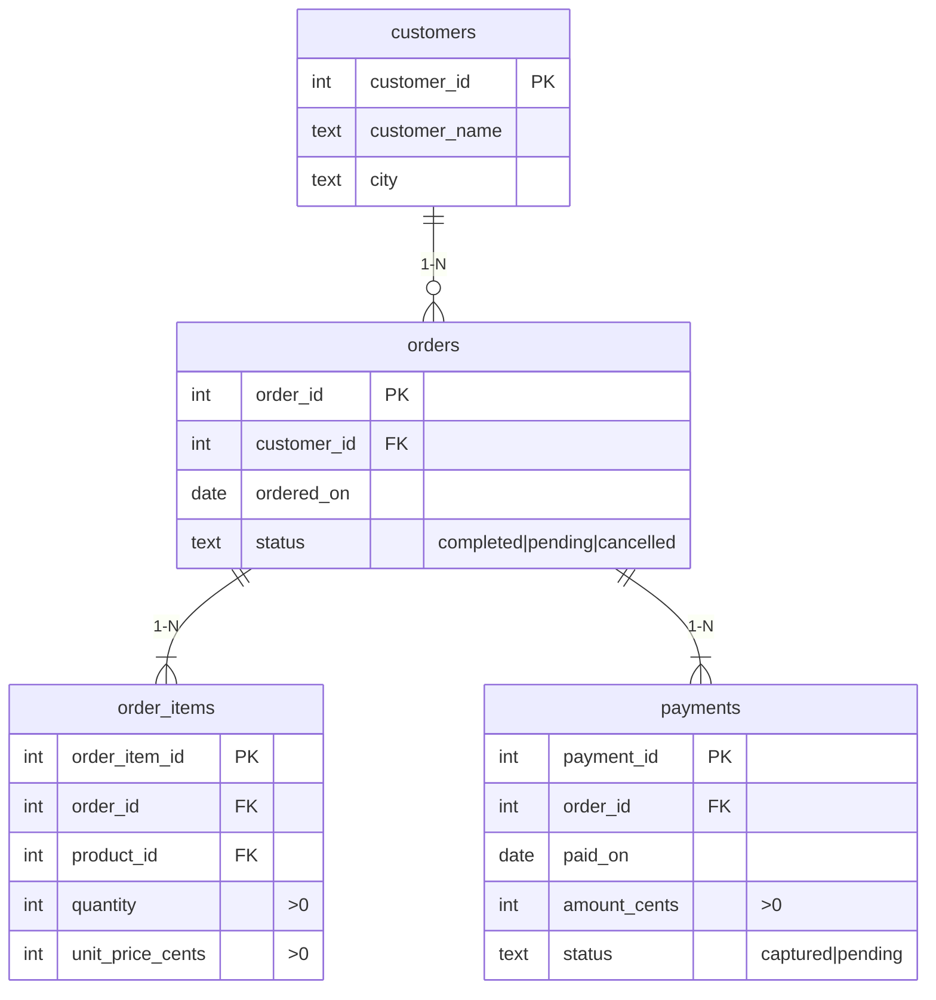

# NovaMarket — S1, S2 et S3 (SQL relationnel, SQL avancé et benchmark, ingestion asynchrone)

**Auteur :** Lucas Massako — M1 Data IA, YNOV

## Exécution

Prérequis : Docker Desktop lancé. Toutes les commandes se lancent depuis `novamarket/`, dans cet ordre :

```bash
bash run_s1.sh    # S1 : schéma, import des ventes, contrôles, indicateurs, anomalies
bash run_s2.sh    # S2 : catalogue et analyses avancées (dépend de S1)
bash run_s3.sh    # S2 M3 : benchmark, génération des 10 000 000 lignes et mesures
```

S3 (Python 3.12, API fournisseur dans Docker) :

```bash
python3.12 -m venv .venv
source .venv/bin/activate
python -m pip install -r requirements-v3.txt
bash run_ingestion.sh   # démarre l'API, lance les collectes clean, séquentielle, panne et atelier
```

Chaque script écrit ses résultats dans `preuves/`. `run_s1.sh` recrée les schémas `reception` et `metier` : il faut ensuite relancer `run_s2.sh`.

| Fichier | Contenu |
|---|---|
| `sql/01_schema.sql` | DDL : schémas `reception`, `metier`, table `reception.rejets` |
| `sql/02_import.sql` | Import CSV / NDJSON, rejets, intégration |
| `sql/03_controles.sql` | Comptages et journal des rejets |
| `sql/04_indicateurs.sql` | Indicateurs S1 |
| `sql/05_anomalies.sql` | Anomalies S1 |
| `sql/06_normalisation_A1.sql` | Approfondissement S1 (normalisation) |
| `sql/07_catalogue.sql` | DDL et import du catalogue |
| `sql/08_controles_catalogue.sql` | Comptages et anomalies du catalogue |
| `sql/09_analyses_avancees.sql` | `RANK`, `LAG` / `LEAD`, CTE, `NTILE`, `WITH RECURSIVE` |
| `s3/generer.sql` | Générateur fourni (schéma `benchmark`) |
| `sql/10_benchmark_mesures.sql` | Plans, script d'index, mesures |
| `ingestion/CONTRAT.md` | Contrat de l'API fournisseur |
| `ingestion/src/collecteur.py` | Collecte asynchrone paginée (aiohttp, asyncio) |
| `ingestion/src/validation.py` | Règles de validation et motifs de rejet |
| `ingestion/src/journalisation.py` | Journal et bilan d'exécution |
| `ingestion/data/` | `raw/`, `valid/`, `rejected/`, `journaux/` (par run) ; lot publié : `valid/offres.jsonl` |

## État du projet

| Séance | Mission | État |
|---|---|---|
| S1 | M1 à M5, A1 | Terminé |
| S2 | M1 à M4, A1 | Terminé |
| S3 | M1 à M4 | Terminé |

---

# S1

## M1 — Modèle relationnel

| Source | Grain | Lignes |
|---|---|---:|
| `customers.csv` | un client | 180 |
| `orders.csv` | une commande | 400 |
| `order_items.csv` | une ligne d'article | 802 |
| `payments.ndjson` | une opération de paiement | 480 |

Relations : un client a N commandes ; une commande a N lignes d'article et N paiements.



Ordre d'import : `customers` → `orders` → `order_items` → `payments`.

Réception : tables `reception.*` en `text`, sans contrainte, avec un `ligne_id` par ligne lue. Les lignes invalides sont écrites dans `reception.rejets` avec leur motif.

**Choix 1 — Réception en texte avant le schéma métier.** Aucune ligne n'est perdue au chargement et chaque rejet est tracé avec sa cause.

**Choix 2 — Montants en `integer` (centimes).** Les sources sont en centimes ; un entier évite les erreurs d'arrondi.

## M2 — Comptages et rejets

| Source | Reçus | Intégrés | Rejetés |
|---|---:|---:|---:|
| customers.csv | 180 | 180 | 0 |
| orders.csv | 400 | 400 | 0 |
| order_items.csv | 802 | 800 | 2 |
| payments.ndjson | 480 | 480 | 0 |

| Source | Ligne | Clé | Motif |
|---|---:|---|---|
| order_items.csv | 801 | order_item_id 7 | doublon de `order_item_id` |
| order_items.csv | 802 | order_item_id 801 | commande 9999 inexistante |

## M3 — Indicateurs

| Indicateur | Résultat | Hypothèse |
|---|---|---|
| Commandes par statut | completed 320, pending 40, cancelled 40 | — |
| Clients sans commande | 30 | — |
| Montant des lignes des commandes terminées | 26 210,00 € | statut `completed` |
| Panier moyen | 81,91 € | dénominateur : 320 commandes `completed` |
| Paiements `captured` des commandes terminées | 26 210,00 € | agrégés par commande avant jointure |

Vérification de cohérence : pour les 400 commandes, total des articles = total des paiements.

## M4 — Anomalies

| Anomalie | Détection | Effet | Décision |
|---|---|---|---|
| Doublon de ligne (id 7, commande 4) | `GROUP BY … HAVING count(*) > 1` | commande 4 : 87,50 € au lieu de 53,75 € | rejet |
| Référence orpheline (commande 9999) | `NOT EXISTS` vers `orders` | 6,25 € sans commande | rejet |
| Jointure articles × paiements | comparaison avec agrégation préalable | 720 lignes au lieu de 320 ; CA 29 472,50 € au lieu de 26 210 € | agréger par commande avant de joindre |
| Statut de commande | même calcul, trois périmètres | completed 26 210 € ; + pending 29 433,75 € ; tous 32 717,50 € | CA = `completed` |

## A1 — Normalisation

`sql/06_normalisation_A1.sql` montre sur `planning_a_normaliser.csv` les anomalies de mise à jour, d'insertion et de suppression, puis le schéma séparé `salles` / `reservations`.

---

# S2

## M1 — Catalogue

| Source | Grain | Reçus | Intégrés | Rejetés |
|---|---|---:|---:|---:|
| categories.csv | une catégorie | 10 | 10 | 0 |
| products.csv | une fiche produit | 25 | 24 | 1 |

Relations : `categories.parent_category_id → categories` ; `products.category_id → categories` ; `order_items.product_id → products`.

**Note d'anomalies**

| Anomalie | Résultat |
|---|---|
| Doublon de fiche produit | produit 3 présent 2 fois (lignes 3 et 25) : 2e rejetée |
| Couverture des codes produit | 24 codes vendus, 24 au catalogue, 0 écart |
| Dates ventes / catalogue | produit 6 vendu dès le 01/09, mis en vente le 15/09 (6 lignes) |

## M2 — Analyses avancées

| Analyse | Partition / grain | Résultat | Limite |
|---|---|---|---|
| `RANK()` produits | global et par catégorie ; 1 ligne = 1 produit | produits 7 et 18 ex æquo au rang 15, rang suivant 17 | les ex æquo partagent le rang |
| `LAG()` / `LEAD()` mensuel | 1 ligne = 1 mois | sept. 9 717,50 € ; oct. 10 261,25 € ; nov. 6 231,25 € | novembre incomplet (19 jours sur 30) |
| CTE | 1 ligne = 1 ligne d'article d'une commande `completed` | total 26 210 € | — |

## M3 — Benchmark


Génération : `s3/generer.sql` (sortie `COMMIT`). Volume : 10 000 000 lignes dans `benchmark.benchmark_sales` (498 Mo).

| Requête | Filtre | Lignes | Part |
|---|---|---:|---:|
| QA | `store_id = 42` | 100 | 0,001 % |
| QB | `store_id = 1` | 9 500 000 | 95 % |

Requête mesurée : `SELECT count(*), sum(amount_cents) FROM benchmark.benchmark_sales WHERE store_id = …`

Conditions de mesure : MacBook Air, Docker limité à 2 CPU et 2 Go, PostgreSQL 17, mesure du 24/11/2026. `EXPLAIN (ANALYZE, BUFFERS)`, premier passage à part, médiane de 3 répétitions. Plans complets dans `preuves/10_benchmark_mesures.txt`.

### Optimisation

```sql
CREATE INDEX benchmark_sales_store_id_idx ON benchmark.benchmark_sales (store_id);
```

Construction : 16,9 s. Taille : 66 Mo (13,3 % de la table).

| Requête | Phase | 1er passage (ms) | Médiane (ms) | Blocs hit / read | Plan |
|---|---|---:|---:|---|---|
| QA | sans index | 715,9 | 965,4 | 2 976 / 60 768 | Parallel Seq Scan |
| QA | avec index | 0,38 | 0,087 | 103 / 0 | Index Scan |
| QB | sans index | 2 216,7 | 2 086,9 | 3 360 / 60 384 | Parallel Seq Scan |
| QB | avec index | 2 019,8 | 2 041,7 | 4 254 / 59 490 | Parallel Seq Scan |
| QB | index forcé | 3 578,1 | 3 419,6 | 265 / 71 429 | Bitmap Heap Scan |

### Analyse critique

| Point | Constat |
|---|---|
| Faible sélectivité | QB retient 95 % des lignes : l'index n'est pas utilisé ; forcé, 3 419,6 ms et 71 429 blocs contre 2 086,9 ms et environ 63 700 blocs |
| Multiplication des lignes | magasin 42 dans 2 campagnes : `JOIN campaign_assignments` donne 200 lignes et 20 200,00 € au lieu de 100 lignes et 10 100,00 € ; `EXISTS` donne 100 lignes |
| Écart estimé / réel | `zone_id = 3 AND channel_id = 3` : 40 424 lignes estimées par worker, 333 333 réelles ; 415 103 estimées après `CREATE STATISTICS (dependencies)` |
| Cache et poste | QB avec index : essais de 1 942,9 à 2 696,7 ms ; mesures valables pour ce poste uniquement |

## M4 — Index inefficace et jointure

- **Index inefficace** : sur `store_id = 1` (95 % des lignes), l'index n'apporte pas de gain ; forcé, la requête passe de 2 086,9 ms à 3 419,6 ms.
- **Jointure qui multiplie les lignes** : le magasin 42 est dans 2 campagnes ; `JOIN campaign_assignments` donne 200 lignes au lieu de 100 et un montant doublé.

## A1 — Compléments

- **`NTILE(4)`** : population = 120 clients ayant au moins une commande `completed` ; 4 groupes de 30.
- **`WITH RECURSIVE`** : 2 racines, profondeur 2, 0 cycle ; CA par branche : Loisirs 17 966,25 €, Maison 8 243,75 €.
- **Estimé / réel** : `zone_id = 3 AND channel_id = 3` estimé à 40 424 lignes par worker, réel 333 333 ; après `CREATE STATISTICS (dependencies)`, estimé 415 103.

---

# S3 — Ingestion asynchrone

## M1 — Contrat HTTP

Contrat complet et exemple de réponse : `ingestion/CONTRAT.md`.

| Élément | Contrat |
|---|---|
| Endpoints | `GET /health`, `GET /offers?page=N&scenario=S&run=R`, `GET /demo` |
| Pagination | `page`, `total_pages` (6), `next_page`, `items` (4 offres par page) |
| Condition d'arrêt | `next_page = null` sur la page 6 |
| Clé métier | `offer_id` |
| Types | `offer_id`, `supplier_id`, `currency`, `observed_on` texte ; `product_id`, `price_cents`, `available_units` entiers |

| Scénario | Observé |
|---|---|
| `clean` | 6 pages en HTTP 200, 24 offres conformes |
| `atelier` | page 2 : 429 + `Retry-After: 1` ; page 3 : 200 avec JSON invalide ; page 4 : délai ; 4 offres non conformes dans des réponses 200 |
| `panne` | page 6 : 503 permanent |

## M2 — Collecteur asynchrone

`ingestion/src/collecteur.py` : page 1 seule (lecture de `total_pages`), puis pages 2 à 6 lancées ensemble avec `asyncio.gather`, au plus 3 requêtes simultanées (`asyncio.Semaphore`), une seule `aiohttp.ClientSession`. Chaque offre garde son numéro de page. Mesures du 24/11/2026 sur le MacBook Air (run `20261124115617`), journal : `preuves/11_ingestion.txt`.

| Run | Concurrence | Pages | Offres | Durée |
|---|---:|---:|---:|---:|
| clean | 3 | 6 | 24 | 0,41 s |
| clean (séquentiel) | 1 | 6 | 24 | 0,87 s |

## M3 — Fiabilisation

| Incident | Traitement |
|---|---|
| Timeout | délai de 1,0 s par requête, nouvel essai |
| 429 | attente égale à `Retry-After`, nouvel essai |
| JSON invalide, réponse incohérente, 5xx | nouvel essai, attente 0,5 s puis 1 s puis 2 s |
| Autre 4xx | arrêt sans nouvel essai |
| Bornes | 4 essais maximum par page ; attente plafonnée à 10 s ; 3 requêtes simultanées |
| Lot incomplet | aucune écriture dans `data/valid/`, bilan en statut `échec`, code retour 1 |

| Run | Statut | Requêtes HTTP | Reprises | Erreurs | Pages reçues |
|---|---|---:|---:|---|---:|
| atelier | publié | 9 | 3 | 429 : 1 ; JSON invalide : 1 ; timeout : 1 | 6 / 6 |
| panne | échec | 9 | 3 | 503 : 4 | 5 / 6 |

## M4 — Validation et traçabilité

Règles (`ingestion/src/validation.py`) : 7 champs requis ; `offer_id`, `supplier_id` texte non vide ; `product_id` entier présent dans `s2/donnees/products.csv` ; `price_cents`, `available_units` entiers ≥ 0 ; `currency = EUR` ; `observed_on` date ISO ; pas de doublon de `offer_id`.

| Dossier | Contenu (JSONL UTF-8) |
|---|---|
| `data/raw/<run>/reponses.jsonl` | chaque réponse reçue : page, essai, statut HTTP, horodatage, corps brut |
| `data/valid/<run>/offres.jsonl` et `data/valid/offres.jsonl` | offres conformes ; le fichier commun n'est remplacé que par un lot complet |
| `data/rejected/<run>/rejets.jsonl` | page, position, motif, objet brut |
| `data/journaux/<run>/` | `collecte.log` et `bilan.json` |

Bilan du scénario `atelier` : 6 pages, 24 offres vues, 20 valides, 4 rejetées, 3 reprises, 1,78 s. Panne : échec après 4,31 s.

| Page | Position | `offer_id` | Motif |
|---:|---:|---|---|
| 2 | 1 | O005 | champ manquant : supplier_id |
| 3 | 2 | O010 | price_cents non entier |
| 5 | 1 | O017 | product_id absent du catalogue |
| 6 | 4 | O001 | doublon de offer_id |
