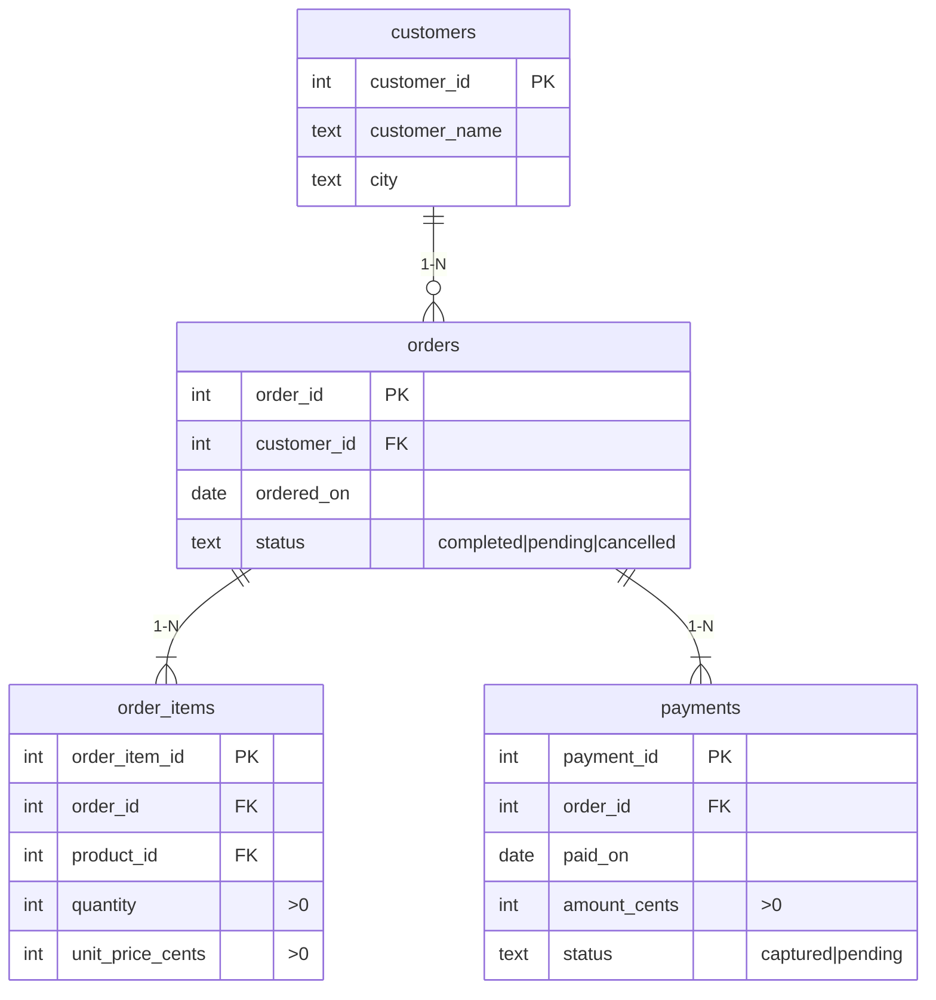

# NovaMarket — S1 et S2 (SQL relationnel, SQL avancé, benchmark)

**Auteur :** Lucas Massako — M1 Data IA, YNOV

## Exécution

Prérequis : Docker Desktop lancé. Toutes les commandes se lancent depuis `novamarket/`, dans cet ordre :

```bash
bash run_s1.sh    # S1 : schéma, import des ventes, contrôles, indicateurs, anomalies
bash run_s2.sh    # S2 : catalogue et analyses avancées (dépend de S1)
bash run_s3.sh    # Benchmark : génération des 10 000 000 lignes et mesures
```

Chaque script écrit ses résultats dans `preuves/`. `run_s1.sh` recrée les schémas `reception` et `metier` : il faut ensuite relancer `run_s2.sh`.

| Fichier | Contenu |
|---|---|
| `sql/01_schema.sql` | DDL : schémas `reception`, `metier`, table `reception.rejets` |
| `sql/02_import.sql` | Import CSV / NDJSON, rejets, intégration |
| `sql/03_controles.sql` | Comptages et journal des rejets |
| `sql/04_indicateurs.sql` | Indicateurs S1 |
| `sql/05_anomalies.sql` | Anomalies S1 |
| `sql/06_normalisation_A1.sql` | Approfondissement S1 (normalisation) |
| `sql/07_catalogue.sql` | DDL et import du catalogue |
| `sql/08_controles_catalogue.sql` | Comptages et anomalies du catalogue |
| `sql/09_analyses_avancees.sql` | `RANK`, `LAG` / `LEAD`, CTE, `NTILE`, `WITH RECURSIVE` |
| `s3/generer.sql` | Générateur fourni (schéma `benchmark`) |
| `sql/10_benchmark_mesures.sql` | Plans, script d'index, mesures |

## État du projet

| Séance | Mission | État |
|---|---|---|
| S1 | M1 à M5, A1 | Terminé |
| S2 | M1 à M4, A1 | Terminé |

---

# S1

## M1 — Modèle relationnel

| Source | Grain | Lignes |
|---|---|---:|
| `customers.csv` | un client | 180 |
| `orders.csv` | une commande | 400 |
| `order_items.csv` | une ligne d'article | 802 |
| `payments.ndjson` | une opération de paiement | 480 |

Relations : un client a N commandes ; une commande a N lignes d'article et N paiements.



Ordre d'import : `customers` → `orders` → `order_items` → `payments`.

Réception : tables `reception.*` en `text`, sans contrainte, avec un `ligne_id` par ligne lue. Les lignes invalides sont écrites dans `reception.rejets` avec leur motif.

**Choix 1 — Réception en texte avant le schéma métier.** Aucune ligne n'est perdue au chargement et chaque rejet est tracé avec sa cause.

**Choix 2 — Montants en `integer` (centimes).** Les sources sont en centimes ; un entier évite les erreurs d'arrondi.

## M2 — Comptages et rejets

| Source | Reçus | Intégrés | Rejetés |
|---|---:|---:|---:|
| customers.csv | 180 | 180 | 0 |
| orders.csv | 400 | 400 | 0 |
| order_items.csv | 802 | 800 | 2 |
| payments.ndjson | 480 | 480 | 0 |

| Source | Ligne | Clé | Motif |
|---|---:|---|---|
| order_items.csv | 801 | order_item_id 7 | doublon de `order_item_id` |
| order_items.csv | 802 | order_item_id 801 | commande 9999 inexistante |

## M3 — Indicateurs

| Indicateur | Résultat | Hypothèse |
|---|---|---|
| Commandes par statut | completed 320, pending 40, cancelled 40 | — |
| Clients sans commande | 30 | — |
| Montant des lignes des commandes terminées | 26 210,00 € | statut `completed` |
| Panier moyen | 81,91 € | dénominateur : 320 commandes `completed` |
| Paiements `captured` des commandes terminées | 26 210,00 € | agrégés par commande avant jointure |

Vérification de cohérence : pour les 400 commandes, total des articles = total des paiements.

## M4 — Anomalies

| Anomalie | Détection | Effet | Décision |
|---|---|---|---|
| Doublon de ligne (id 7, commande 4) | `GROUP BY … HAVING count(*) > 1` | commande 4 : 87,50 € au lieu de 53,75 € | rejet |
| Référence orpheline (commande 9999) | `NOT EXISTS` vers `orders` | 6,25 € sans commande | rejet |
| Jointure articles × paiements | comparaison avec agrégation préalable | 720 lignes au lieu de 320 ; CA 29 472,50 € au lieu de 26 210 € | agréger par commande avant de joindre |
| Statut de commande | même calcul, trois périmètres | completed 26 210 € ; + pending 29 433,75 € ; tous 32 717,50 € | CA = `completed` |

## A1 — Normalisation

`sql/06_normalisation_A1.sql` montre sur `planning_a_normaliser.csv` les anomalies de mise à jour, d'insertion et de suppression, puis le schéma séparé `salles` / `reservations`.

---

# S2

## M1 — Catalogue

| Source | Grain | Reçus | Intégrés | Rejetés |
|---|---|---:|---:|---:|
| categories.csv | une catégorie | 10 | 10 | 0 |
| products.csv | une fiche produit | 25 | 24 | 1 |

Relations : `categories.parent_category_id → categories` ; `products.category_id → categories` ; `order_items.product_id → products`.

**Note d'anomalies**

| Anomalie | Résultat |
|---|---|
| Doublon de fiche produit | produit 3 présent 2 fois (lignes 3 et 25) : 2e rejetée |
| Couverture des codes produit | 24 codes vendus, 24 au catalogue, 0 écart |
| Dates ventes / catalogue | produit 6 vendu dès le 01/09, mis en vente le 15/09 (6 lignes) |

## M2 — Analyses avancées

| Analyse | Partition / grain | Résultat | Limite |
|---|---|---|---|
| `RANK()` produits | global et par catégorie ; 1 ligne = 1 produit | produits 7 et 18 ex æquo au rang 15, rang suivant 17 | les ex æquo partagent le rang |
| `LAG()` / `LEAD()` mensuel | 1 ligne = 1 mois | sept. 9 717,50 € ; oct. 10 261,25 € ; nov. 6 231,25 € | novembre incomplet (19 jours sur 30) |
| CTE | 1 ligne = 1 ligne d'article d'une commande `completed` | total 26 210 € | — |

## M3 — Benchmark

10 000 000 lignes dans `benchmark.benchmark_sales` (498 Mo).

Filtres : `store_id = 42` (100 lignes, 0,001 %) et `store_id = 1` (9 500 000 lignes, 95 %).

Index : `CREATE INDEX benchmark_sales_store_id_idx ON benchmark.benchmark_sales (store_id);` — construction 16,9 s, taille 66 Mo.

Mesures : premier passage à part, médiane de 3 répétitions. Plans complets dans `preuves/10_benchmark_mesures.txt`.

| Requête | Phase | 1er passage (ms) | Médiane (ms) | Plan |
|---|---|---:|---:|---|
| store 42 | sans index | 715,9 | 965,4 | Parallel Seq Scan |
| store 42 | avec index | 0,38 | 0,087 | Index Scan |
| store 1 | sans index | 2 216,7 | 2 086,9 | Parallel Seq Scan |
| store 1 | avec index | 2 019,8 | 2 041,7 | Parallel Seq Scan |
| store 1 | index forcé | 3 578,1 | 3 419,6 | Bitmap Heap Scan |

Commentaire : l'index accélère le filtre sélectif (store 42) ; il n'est pas utilisé pour le filtre large (store 1).

## M4 — Index inefficace et jointure

- **Index inefficace** : sur `store_id = 1` (95 % des lignes), l'index n'apporte pas de gain ; forcé, la requête passe de 2 086,9 ms à 3 419,6 ms.
- **Jointure qui multiplie les lignes** : le magasin 42 est dans 2 campagnes ; `JOIN campaign_assignments` donne 200 lignes au lieu de 100 et un montant doublé.

## A1 — Compléments

- **`NTILE(4)`** : population = 120 clients ayant au moins une commande `completed` ; 4 groupes de 30.
- **`WITH RECURSIVE`** : 2 racines, profondeur 2, 0 cycle ; CA par branche : Loisirs 17 966,25 €, Maison 8 243,75 €.
- **Estimé / réel** : `zone_id = 3 AND channel_id = 3` estimé à 40 424 lignes par worker, réel 333 333 ; après `CREATE STATISTICS (dependencies)`, estimé 415 103.
