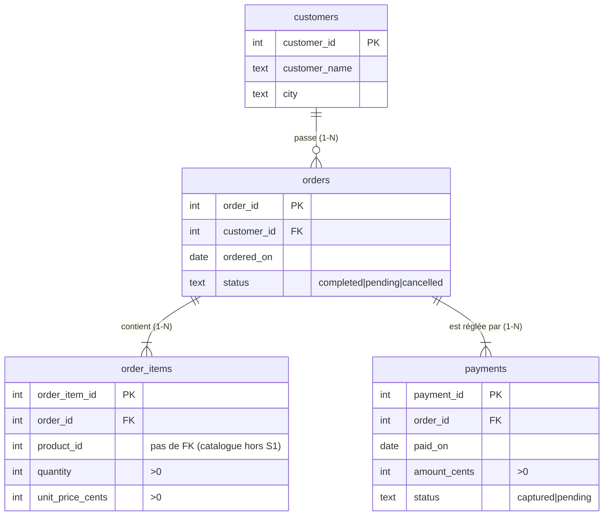

# NovaMarket — S1 : SQL relationnel et premiers indicateurs

**Auteur :** Lucas Massako — M1 Data IA, YNOV

Base PostgreSQL 17 (Docker) construite à partir des quatre fichiers de `s1/donnees/`. Tous les montants sont en **centimes** (`integer`) et ne sont convertis en euros qu'à l'affichage.

## Exécution

Prérequis : Docker Desktop lancé. Toutes les commandes se tapent depuis `novamarket/`.

```bash
bash run_s1.sh        
```

Pour lancer les scripts un par un :

```bash
docker compose up -d --wait postgres
docker compose exec -T postgres psql -X -v ON_ERROR_STOP=1 -U atelier -d novamarket < sql/01_schema.sql
docker compose exec -T postgres psql -X -v ON_ERROR_STOP=1 -U atelier -d novamarket < sql/02_import.sql
docker compose exec -T postgres psql -X -U atelier -d novamarket < sql/03_controles.sql
```

| Fichier | Rôle | Mission |
|---|---|---|
| `sql/01_schema.sql` | Schémas `reception` (brut, texte) et `metier` (typé, contraint), table `reception.rejets` | M1, M2 |
| `sql/02_import.sql` | `\copy` CSV/NDJSON → réception → journal des rejets → métier, dans une seule transaction | M2 |
| `sql/03_controles.sql` | Volumes reçus / intégrés / rejetés, journal des rejets, contrôles de cohérence | M2, M5 |
| `sql/04_indicateurs.sql` | Commandes par statut, clients sans commande, CA, panier moyen, rapprochement des paiements | M3 |
| `sql/05_anomalies.sql` | Doublons, orphelins, multiplication des montants par jointure, effet du statut sur le CA | M4 |
| `sql/06_normalisation_A1.sql` | Anomalies d'insertion, de mise à jour et de suppression, puis version normalisée (tout est annulé par ROLLBACK) | A1 |
| `.env` | Port hôte (`15432`) et sous-réseau Docker, à modifier en cas de conflit | — |

Les scripts sont **rejouables** : `01` recrée les schémas et `02` vide puis recharge. Les fichiers bruts de `s1/` ne sont jamais modifiés, car ils sont montés en lecture seule.

## M1 — Modèle relationnel

Grain de chaque source : une ligne = un client, une commande, une ligne d'article ou une opération de paiement.



L'ordre d'import suit les dépendances : `customers` → `orders` → `order_items` et `payments`.

**Choix de conception justifiés**

1. **Réception en texte, puis métier contraint.** Les tables `reception.*` n'ont ni types ni contraintes, donc aucune ligne ne peut faire échouer le `\copy`. Chaque ligne garde un `ligne_id` (sa position dans le fichier). Les règles sont ensuite vérifiées en SQL. Une ligne invalide va dans `reception.rejets`, avec son motif et son contenu brut, au lieu d'arrêter l'import ou de disparaître. On peut ainsi toujours vérifier que reçus = intégrés + rejetés.
2. **Montants en `integer` (centimes) et prix stocké sur la ligne.** On évite les erreurs d'arrondi des flottants. `unit_price_cents` est le prix au moment de l'achat : il reste sur la ligne d'article et n'est pas déduit d'un catalogue. C'est aussi pourquoi `product_id` n'a pas de clé étrangère (le catalogue est hors périmètre S1).

Autres contraintes : clés primaires sur chaque identifiant source, clés étrangères vers `orders` et `customers`, `CHECK` sur les statuts (sensibles à la casse) et sur les valeurs strictement positives, index sur les clés étrangères.

## M2 — Volumes

| Source | Reçus | Intégrés | Rejetés |
|---|---:|---:|---:|
| customers.csv | 180 | 180 | 0 |
| orders.csv | 400 | 400 | 0 |
| order_items.csv | 802 | 800 | 2 |
| payments.ndjson | 480 | 480 | 0 |

**Journal des rejets** (`reception.rejets`)

| Source | Ligne | Clé | Motif |
|---|---:|---|---|
| order_items.csv | 801 | order_item_id 7 | doublon de `order_item_id` (même commande 4, même produit, mêmes valeurs ; 1re occurrence conservée) |
| order_items.csv | 802 | order_item_id 801 | commande 9999 inexistante (référence orpheline) |

## M3 — Indicateurs

| Indicateur | Résultat | Hypothèse / dénominateur |
|---|---|---|
| Commandes par statut | completed 320 (80 %), pending 40, cancelled 40 | 400 commandes intégrées |
| Clients sans commande | 30 sur 180 | `NOT EXISTS` sur `orders` |
| CA des lignes des commandes terminées | **26 210,00 €** (2 621 000 centimes) | Σ `quantity × unit_price_cents`, statut `completed` uniquement |
| Panier moyen | **81,91 €** | CA ÷ **320 commandes completed** (pas ÷ 800 lignes, pas ÷ 360 paiements) |
| Encaissé sur commandes completed | 26 210,00 € | Paiements `captured`, agrégés par commande avant la jointure |

**Contrôle de cohérence** : après rejet du doublon, les 400 commandes ont un total d'articles égal à la somme de leurs paiements (les deux sont agrégés par commande). Les commandes completed sont entièrement `captured`, les commandes pending entièrement `pending`.

## M4 — Anomalies

| Anomalie | Détection | Effet si on l'ignore | Décision |
|---|---|---|---|
| Ligne d'article en double (id 7, commande 4) | `GROUP BY` sur toutes les colonnes, `HAVING count(*) > 1` | Commande 4 à 87,50 € au lieu de 53,75 €, alors que 53,75 € ont été payés ; CA surévalué de 33,75 € | Rejet de la 2e occurrence, tracé dans le journal |
| Ligne d'article orpheline (commande 9999) | `NOT EXISTS` vers `orders` | Montant de 6,25 € rattaché à aucune commande ; la clé étrangère bloquerait l'import | Rejet, tracé dans le journal |
| Jointure directe articles × paiements | Comparer avec une agrégation préalable par commande | Lignes multipliées : 720 au lieu de 320 ; CA 29 472,50 € au lieu de 26 210 € (+12 %) ; paiements 52 420 € au lieu de 26 210 € (×2) | Toujours agréger chaque table par commande **avant** de joindre |
| Paiements en deux fois de même montant (ex. commande 5 : 2 × 27,50 €) | `GROUP BY order_id, montant, date` | Les supprimer comme faux doublons sous-évaluerait les encaissements | **Conservés** : `payment_id` distincts et somme égale au total des articles |
| Commandes annulées mais encaissées (40 commandes, 3 283,75 € captured) | Jointure `orders.status = 'cancelled'` et `payments.status = 'captured'` | Gonfle l'encaissé si on ne filtre pas sur le statut de la commande ; remboursements absents des sources | Exclues du CA, signalées au métier (remboursements à confirmer) |
| Périmètre du CA selon le statut | Même calcul avec trois filtres | completed 26 210 € / + pending 29 433,75 € / tous statuts 32 717,50 € | CA retenu = `completed` ; pending suivi à part |

## Décisions métier validées

Validées par Lucas Massako le 23/11/2026.

| # | Sujet | Décision | Justification |
|---|---|---|---|
| D1 | Périmètre du CA | Commandes `completed` uniquement (26 210 €). Les `pending` (3 223,75 €) sont suivies à part comme CA potentiel | Seule une vente terminée est acquise ; une commande en attente peut encore être annulée |
| D2 | Panier moyen | CA completed ÷ nombre de commandes completed (320), soit 81,91 € | Le dénominateur doit être au même grain et dans le même périmètre que le numérateur |
| D3 | Commandes annulées mais encaissées (40 commandes, 3 283,75 €) | Exclues du CA et signalées comme anomalie à vérifier avec le métier | Sans trace de remboursement, on ne peut ni les compter comme ventes ni les ignorer |
| D4 | Ligne d'article en double (id 7, commande 4) | 2e occurrence rejetée et tracée dans le journal | Mêmes identifiant et valeurs ; le paiement de 53,75 € confirme le total sans doublon |
| D5 | Ligne d'article orpheline (commande 9999) | Rejetée et tracée | Aucune commande à laquelle la rattacher ; on refuse d'inventer une commande |
| D6 | Paiements identiques sur une même commande | Conservés comme paiements en deux fois | `payment_id` distincts et somme égale au total des articles de la commande |

## A1 — Normalisation (approfondissement)

Le script `06_normalisation_A1.sql` reprend `planning_a_normaliser.csv`, où nom de salle et responsable sont répétés à chaque réservation. Il montre trois anomalies :
- **mise à jour** : changer le responsable sur une seule ligne donne deux responsables pour la même salle ;
- **insertion** : impossible de créer une salle qui n'a pas encore de réservation ;
- **suppression** : supprimer la dernière réservation d'une salle efface la salle elle-même.

La version normalisée sépare `salles` (salle_id, nom, responsable) et `reservations` (reservation_id, salle_id en clé étrangère), ce qui supprime les trois anomalies.

